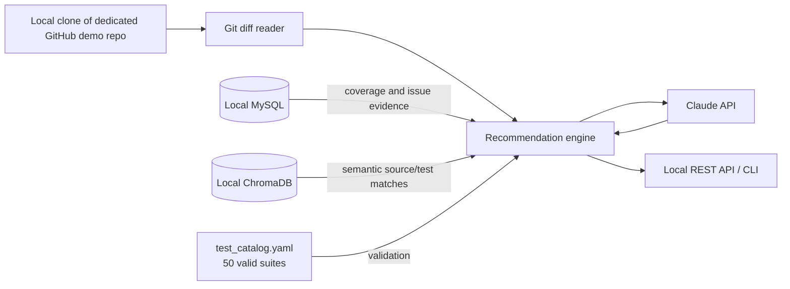
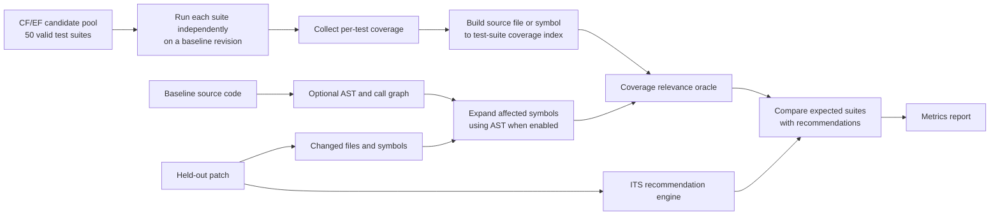

# Local Synthetic Test-Recommendation Demo Plan

## Objective

Build a self-contained local demo that recommends a small set of networking test
suites for a changed Git commit. The demo must use only fictional code, paths,
test names, issue IDs, and data. It must not connect to production services or
use product source code.

## Target outcome

For a commit that changes a fictional networking file, the local API returns
known, valid test suites together with the evidence that selected them.

```json
{
  "commit_sha": "<sha>",
  "changed_files": ["src/relay/route_table.py"],
  "recommendations": [
    {
      "area_suite": "RelayMesh::RouteRecovery",
      "confidence": 94,
      "sources": ["coverage", "jira", "semantic"],
      "reason": "The changed route-table code is covered by this suite and is linked to DEMO-1842."
    }
  ]
}
```

## Scope

### Included

- A GitHub repository containing a fictional networking application.
- 10,000 synthetic commits with believable change and issue history.
- Fifty hardcoded test suites in a local YAML test catalog.
- Local MySQL tables for coverage, Bugzilla, Jira, and commit metadata.
- ChromaDB for local source/test embeddings.
- A recommendation service that combines deterministic evidence and Claude
  ranking.
- Repeatable data generation using a fixed random seed.

### Explicitly excluded from the first version

- Production Gerrit, Jenkins, CIBot, MongoDB, Qdrant, Bugzilla, Jira, and
  product source code.
- Real test execution or real code-coverage instrumentation.
- AST dependency analysis. It can be added after the deterministic and semantic
  demo works.
- Pushing generated commits unless the supplied GitHub repository is explicitly
  dedicated to this demo.

## Fictional repository model

Use only invented names. The example below is a fictional community-mesh
application, not a representation of any product codebase.

```text
mesh-harbor-demo/
├── src/
│   ├── relay/
│   │   ├── peer_registry.py
│   │   ├── route_table.py
│   │   └── heartbeat.py
│   ├── parcels/
│   │   ├── packet_queue.py
│   │   ├── packet_codec.py
│   │   └── delivery_tracker.py
│   ├── signals/
│   │   ├── channel_monitor.py
│   │   ├── link_quality.py
│   │   └── beacon_service.py
│   ├── docks/
│   │   ├── node_enrollment.py
│   │   ├── access_rules.py
│   │   └── connection_limits.py
│   └── observatory/
│       ├── traffic_snapshot.py
│       └── route_metrics.py
├── tests/
├── test_catalog.yaml
└── README.md
```

Each source component owns related test suites. For example,
`src/relay/route_table.py` strongly maps to `RelayMesh::RouteRecovery` and may
weakly map to `RelayMesh::PeerRegistry`.

## Local architecture



Claude ranks only candidates already produced by the catalog, coverage, issue,
and semantic layers. It must not be allowed to invent test-suite names.

## Required inputs

Provide these when implementation begins:

1. A dedicated GitHub repository URL and confirmation that it may receive
   generated commits. A local clone is sufficient if pushes are not required.
2. MySQL host, port, database name, username, and a secure method to supply the
   password.
3. Claude API key through an environment variable, never in source control or
   chat messages.
4. Whether the demo uses local-only commits or pushes all generated history to
   GitHub.

## Local configuration

Create an untracked `.env` file from `.env.example`:

```bash
MYSQL_HOST=127.0.0.1
MYSQL_PORT=3306
MYSQL_DATABASE=mesh_demo
MYSQL_USER=mesh_demo
MYSQL_PASSWORD=replace_me
ANTHROPIC_API_KEY=replace_me
CHROMA_PATH=./data/chroma
SYNTHETIC_SEED=20261009
```

Do not commit `.env`, database dumps containing secrets, or API keys.

## Test catalog

Store the fixed recommendation universe in `test_catalog.yaml`. Fifty suites are
enough for a representative demo; a separate database catalog is unnecessary.

Each entry needs:

```yaml
- id: relay_route_recovery
  area_suite: RelayMesh::RouteRecovery
  pipeline: verification
  test_file: tests/relay/test_route_recovery.py
  owned_paths:
    - src/relay/route_table.py
    - src/relay/heartbeat.py
  estimated_runtime_seconds: 90
```

Use approximately 50 suites spread across `RelayMesh`, `PacketFlow`,
`SignalWatch`, `DockAccess`, and `Observatory`.

## MySQL data model

### `coverage_mapping`

This is the primary deterministic selector input.

```sql
CREATE TABLE coverage_mapping (
    id BIGINT AUTO_INCREMENT PRIMARY KEY,
    source_path VARCHAR(512) NOT NULL,
    source_symbol VARCHAR(255) NULL,
    test_id VARCHAR(128) NOT NULL,
    area_suite VARCHAR(255) NOT NULL,
    line_coverage DECIMAL(5,2) NOT NULL,
    function_coverage DECIMAL(5,2) NOT NULL,
    commit_sha CHAR(40) NOT NULL,
    branch_name VARCHAR(128) NOT NULL,
    generated_at TIMESTAMP NOT NULL DEFAULT CURRENT_TIMESTAMP,
    INDEX idx_coverage_source_path (source_path),
    INDEX idx_coverage_commit_sha (commit_sha),
    INDEX idx_coverage_area_suite (area_suite)
);
```

### `jira_mapping`

```sql
CREATE TABLE jira_mapping (
    id BIGINT AUTO_INCREMENT PRIMARY KEY,
    jira_key VARCHAR(32) NOT NULL,
    commit_sha CHAR(40) NOT NULL,
    source_path VARCHAR(512) NOT NULL,
    area_suite VARCHAR(255) NOT NULL,
    issue_summary VARCHAR(512) NOT NULL,
    created_at TIMESTAMP NOT NULL DEFAULT CURRENT_TIMESTAMP,
    INDEX idx_jira_key (jira_key),
    INDEX idx_jira_commit_sha (commit_sha),
    INDEX idx_jira_source_path (source_path)
);
```

### `bugzilla_mapping`

```sql
CREATE TABLE bugzilla_mapping (
    id BIGINT AUTO_INCREMENT PRIMARY KEY,
    bug_id BIGINT NOT NULL,
    commit_sha CHAR(40) NOT NULL,
    source_path VARCHAR(512) NOT NULL,
    area_suite VARCHAR(255) NOT NULL,
    bug_summary VARCHAR(512) NOT NULL,
    severity ENUM('low', 'medium', 'high', 'critical') NOT NULL,
    created_at TIMESTAMP NOT NULL DEFAULT CURRENT_TIMESTAMP,
    INDEX idx_bug_id (bug_id),
    INDEX idx_bug_commit_sha (commit_sha),
    INDEX idx_bug_source_path (source_path)
);
```

### `commit_metadata`

This makes synthetic history queryable without repeatedly walking Git.

```sql
CREATE TABLE commit_metadata (
    commit_sha CHAR(40) PRIMARY KEY,
    parent_sha CHAR(40) NULL,
    branch_name VARCHAR(128) NOT NULL,
    author_name VARCHAR(128) NOT NULL,
    commit_message TEXT NOT NULL,
    changed_files JSON NOT NULL,
    linked_jira_key VARCHAR(32) NULL,
    linked_bug_id BIGINT NULL,
    committed_at DATETIME NOT NULL,
    INDEX idx_commit_jira (linked_jira_key),
    INDEX idx_commit_bug (linked_bug_id)
);
```

## Synthetic data rules

Generated data must be correlated, not independently random.

1. Assign every source file to one fictional component.
2. Assign every component three to six strongly related test suites.
3. Give each file one to three high-coverage mappings and zero to two lower-
   confidence neighbouring mappings.
4. Make each synthetic commit change one to three files, primarily from one
   component.
5. Put a fictional issue reference in a subset of commit messages, such as
   `DEMO-1842` or `BUG-731`.
6. Map that issue to the same changed paths and their component’s valid suites.
7. Preserve a fixed seed so the complete demo can be recreated exactly.

Example relationship:

```text
Commit: DEMO-1842 Correct relay route expiration
Changed: src/relay/route_table.py
Coverage: RelayMesh::RouteRecovery at 93 percent
Jira: DEMO-1842 -> RelayMesh::RouteRecovery
Bug: BUG-731 -> RelayMesh::PeerRegistry
Expected recommendation: RouteRecovery first, PeerRegistry as a secondary candidate
```

## Commit-history generation

Create source and test files first, then produce 10,000 commits using scripted,
small changes. Spread commits across fictional authors, components, fix/feature/
refactor/documentation categories, and dates.

Recommended commit distribution:

| Type | Approximate share |
| --- | ---: |
| Single-component feature or fix | 60% |
| Multi-file change in one component | 20% |
| Cross-component change | 10% |
| Documentation or non-functional change | 10% |

The generator must record the resulting SHA in MySQL immediately after each
commit, then create the matching coverage and issue mappings. Generate locally
first; push only after validating the history and receiving confirmation.

## ChromaDB index

Use ChromaDB locally for the first implementation.

Index source functions/classes and test descriptions separately. Store metadata
needed to filter results to valid suites:

```text
id, document_type, path, symbol_name, language, text, area_suite, test_id, commit_sha
```

Recommended document types:

- `source`: source-file chunks or functions
- `test`: test code and test description
- `suite`: catalog description plus owned paths
- `commit`: selected commit diff summaries

Use a fixed embedding model and record its name/version in index metadata so
results remain reproducible. Rebuild the index after generating the repository.

## Recommendation algorithm

1. Receive a commit SHA, branch, or local diff.
2. Read changed paths and diff from local Git.
3. Look up coverage mappings for the changed paths.
4. Look up Jira and Bugzilla mappings by commit SHA and changed path.
5. Search Chroma for semantically similar source and test documents.
6. Merge and score candidates. Coverage should carry the highest base score;
   exact issue links add a large boost; semantic matches add a smaller boost.
7. Filter candidates against `test_catalog.yaml`.
8. Send only valid candidate suites, evidence, and diff summary to Claude for
   ranking and concise explanation.
9. Validate Claude’s returned names against the catalog again.
10. Return the top three to five recommendations with source evidence.

## Implementation phases

### Phase 1: Foundation

- Create local project structure, virtual environment, `.env.example`, and
  Docker Compose configuration for MySQL and ChromaDB if desired.
- Add the fictional 50-suite test catalog.
- Create and validate MySQL schema.

### Phase 2: Synthetic repository and history

- Generate fictional networking source and test files.
- Generate 10,000 local commits with deterministic metadata.
- Populate `commit_metadata`, `coverage_mapping`, `jira_mapping`, and
  `bugzilla_mapping` in the same generation run.

### Phase 3: Semantic retrieval

- Chunk source and test files.
- Generate embeddings and load ChromaDB.
- Verify path, metadata, and test-suite filtering.

### Phase 4: Recommendation service

- Implement a local CLI first, then a small REST API.
- Add deterministic scoring, Chroma retrieval, catalog validation, and Claude
  ranking.
- Load the Claude key from `ANTHROPIC_API_KEY` only.

### Phase 5: Evaluation and demo

- Hold out at least 200 generated commits as an evaluation set.
- Compare recommended suites with the known mappings used to generate each
  commit.
- Report precision, recall, top-1 accuracy, top-3 accuracy, and response time.
- Demonstrate three scenarios: direct coverage match, issue-linked regression,
  and semantic-only fallback.

## Proposed evaluation pipeline

The evaluation pipeline validates whether the recommendation system selects tests
that are relevant to a change. It uses a fixed CF/EF candidate pool of 50
fictional test suites and is entirely local to the synthetic demo environment.



### Coverage collection

Run each suite separately, rather than collecting one aggregate pipeline coverage
report. Aggregate coverage only identifies files touched by the full pipeline; it
cannot identify the particular suite responsible for a file or function.

The coverage result for every suite must contain at least:

```text
test_id, area_suite, source_path, source_symbol, line_coverage, function_coverage, baseline_sha
```

This produces a deterministic lookup such as:

```text
src/relay/route_table.py::expire_routes
  → RelayMesh::RouteRecovery
  → RelayMesh::PeerRegistry
```

### Optional AST impact layer

AST analysis is optional for the MVP and must be treated as a separate source of
evidence from coverage. It is not generated from coverage data.

- Coverage answers: “Which suite exercised this file or symbol?”
- AST answers: “Which functions, imports, or direct calls are affected by this
  change?”

For a Python-only demo, use the standard-library `ast` module to extract
functions, classes, imports, and direct calls. Limit graph traversal to one to
three hops. Use the resulting impacted symbols to expand the coverage lookup.

### Relevance oracle

For every held-out patch:

1. Read its changed files and, when enabled, changed symbols.
2. Use the coverage index and optional AST impact graph to calculate the expected
   relevant suites.
3. Run ITS using only evidence available before the patch’s timestamp.
4. Compare the ITS top-k results with the expected relevant suites.

Example:

```text
Changed symbol: src/relay/route_table.py::expire_routes
Expected suites: RelayMesh::RouteRecovery, RelayMesh::PeerRegistry
ITS top two: RelayMesh::RouteRecovery, Observatory::RouteMetrics

Top-2 recall: 50 percent
Precision at 2: 50 percent
Missed suite: RelayMesh::PeerRegistry
Unexpected suite: Observatory::RouteMetrics
```

This is a **coverage/AST relevance oracle**. It demonstrates structural relevance,
but does not prove that a suite detects a real defect.

### Fault-detection oracle

Create a smaller set of intentionally defective synthetic commits. Each fault is
introduced in a known source component and has one or more tests designed to
fail when that defect exists.

For each fault-injected commit:

1. Run the full 50-suite candidate pool.
2. Record the suites that actually fail as the fault-detection ground truth.
3. Run ITS before executing the full suite set.
4. Measure whether ITS selected the failing suite in its top-k recommendations.

This is the strongest validation metric because it answers: “Would ITS have
selected a test that exposes the injected regression?”

### Evaluation scorecard

Report metrics separately for relevance and fault detection:

| Metric | Definition | Purpose |
| --- | --- | --- |
| Top-1 accuracy | Top recommendation is an expected suite. | Ranking quality. |
| Top-3 recall | At least one expected suite appears in top three. | Practical selection safety. |
| Precision at k | Relevant recommended suites divided by k. | Avoiding excess tests. |
| Critical miss rate | Fault-detecting suite omitted from top-k. | Highest-priority safety metric. |
| Invalid-suite rate | Recommendation not in `test_catalog.yaml`. | Must be zero. |
| Test-count reduction | Recommended test count versus 50-suite pool. | Efficiency gain. |
| Estimated runtime reduction | Runtime avoided versus the full pool. | CI capacity value. |
| Latency | Time to produce a recommendation. | Operational usability. |

### Evaluation integrity

- Hold out at least 100 to 200 commits for relevance evaluation and keep them
  out of index-building and tuning decisions.
- Split data by time; do not randomly mix related commits or patch chains.
- Restrict every recommendation to `test_catalog.yaml`.
- Use only mappings, issue links, coverage, and embeddings available before the
  held-out patch.
- Record data snapshot, catalog version, embedding model, Claude model, prompt
  version, configuration, and random seed with every run.
- Describe results externally as a **controlled synthetic validation harness**,
  not production validation.

## Acceptance criteria

- The repository contains 10,000 reproducible fictional commits.
- No real product paths, names, credentials, or production URLs appear in the
  generated repository or data.
- Exactly 50 catalog suites are valid recommendation targets.
- Every generated commit has consistent metadata and at least one expected suite.
- The API never returns a suite not in `test_catalog.yaml`.
- At least one recommendation is returned for a known changed networking file.
- The response shows the supporting evidence: coverage, Jira, Bugzilla, and/or
  semantic retrieval.
- Re-running with the same seed recreates the same mappings and expected results.

## Decisions to make before implementation

1. Is the GitHub repository private and dedicated to synthetic demo data?
2. Should all 10,000 commits be pushed, or should GitHub receive a smaller,
   representative subset after local generation?
3. Which language should the fictional application use: Python only,
   Java only, or a mix?
4. Should MySQL run locally through Docker Compose or connect to an existing
   non-production MySQL instance?
5. Do you want a CLI-only demo first, or a web UI as part of the first release?
